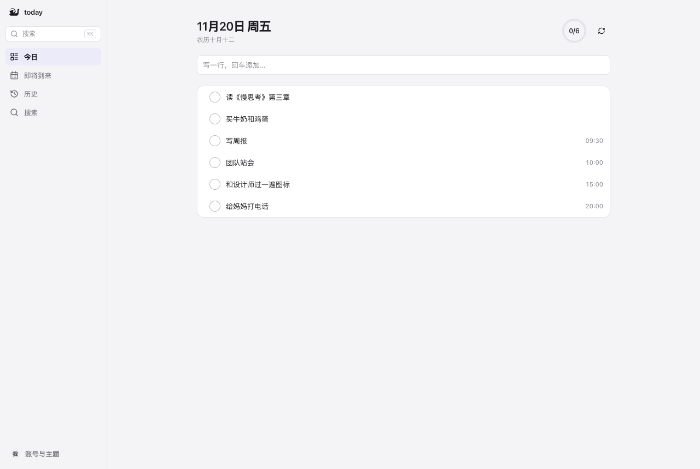
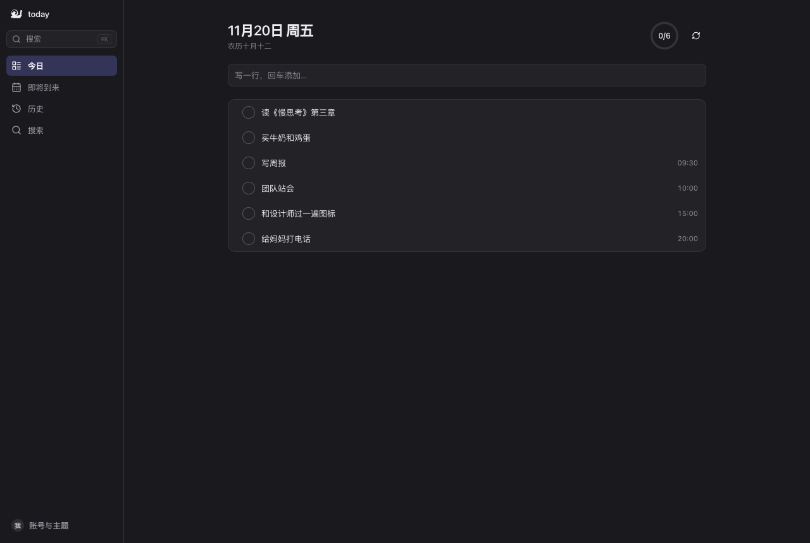

# Today

Mac mini 上的单用户「今天」应用：菜单栏外壳 + 本地 HTTP 服务 + 一块 4.2" 反射 LCD。界面有三处——菜单栏的托盘面板、一个设置窗口、以及浏览器里的网页，全部由同一套 Go 规则层（`internal/server`）驱动；SQLite 是唯一真源，设备只拿到一张已经排好版的 1-bit 位图。



## 硬件

- **微雪 ESP32-S3-RLCD-4.2**（ESP32-S3-WROOM-1-N16R8，16 MB Flash / 8 MB PSRAM）
- 4.2" ST7305 全反射 LCD，400×300，1-bit，**无背光**
- 板上：1×18650 电池座、SHTC3 温湿度、PCF85063 RTC、双麦克风/ES8311、TF 卡槽
- 两个可编程键：KEY（下一项 / 长按勾选 / 3 s 配网）、BOOT（强制刷新）
- 常亮模式，需要 USB 供电；深睡电流约 6–7 mA，电池只适合短时移动

## 界面

- **托盘面板**：点菜单栏的图标弹出，今天的进度、事项、设备状态与一行天气；勾选、快速添加都在这里完成。右键仍然是原生菜单。
- **设置窗口**：常规、设备、显示与声音、网络、数据、关于六组。
- **网页**：今日、即将到来、历史、搜索四个页面，桌面 1280 与手机 390 都排好版。



<p align="center">
  
</p>

## 文档

- **→ [刷机教程](docs/flashing.md)**：数据线、下载模式、免工具链刷合并镜像、从源码编译、首次配网、OTA、恢复出厂、故障排查
- **→ [使用教程](docs/usage.md)**：安装、口令、今日/事项/历史/设置、设备双键、夜间熄屏、Tailscale Funnel、备份与卸载
- **→ [开发](docs/developing.md)**：目录结构、`go test ./...`、`todayd` 子命令、帧契约与固件测试、前端工作区

## 快速开始

```sh
cd firmware && ./flash.sh doctor && ./flash.sh build && ./flash.sh flash
go test ./...                  # 服务端与帧渲染，不需要 Node
go run . --dev                 # 菜单栏应用（托盘 + 本地服务）
```

前端（Mac app 的 Svelte 页面与网页的 React 页面）在 `frontend/`，需要 Node 22 与 pnpm 12：

```sh
pnpm -C frontend install
pnpm -C frontend build         # 或者 scripts/build-web.sh，会同时嵌入网页
go tool mygo build             # 出 Today.app 与 dmg
```

固件、协议与版式的细节见 `firmware/README.md` 和 `docs/PLAN.md`（后者是本地设计文档，不进 git）。
