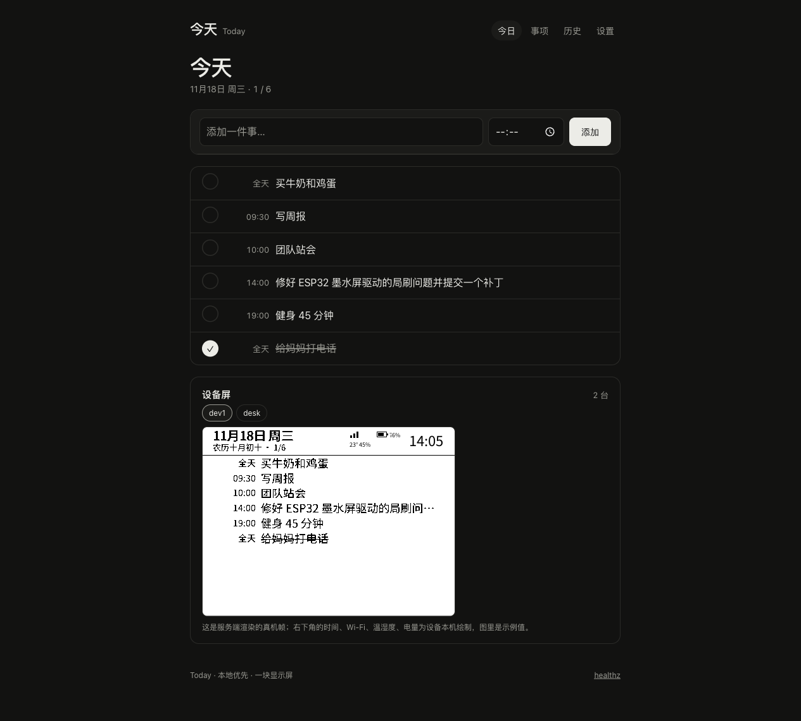
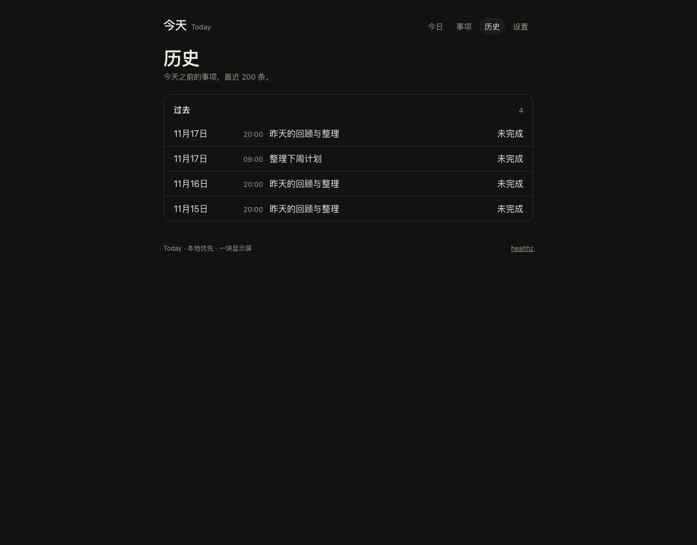
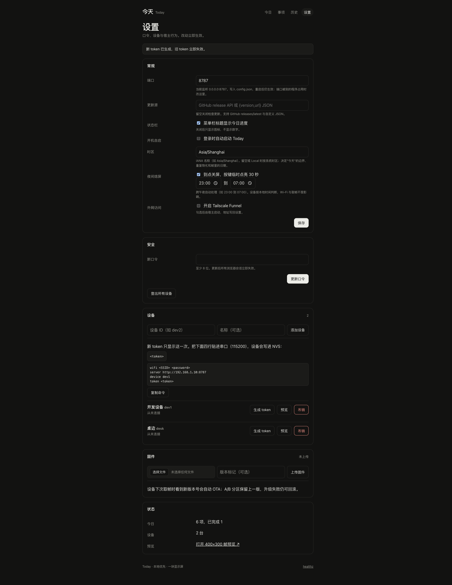

# 使用教程

Today 是 macOS 菜单栏里的一个「今天」应用：网页是唯一界面，一块 4.2" 反射 LCD 常亮显示今天的事项。数据全部在本机 SQLite 里。



## 1. 安装

1. 下载 `Today-<版本>.dmg`，打开后把 `Today.app` 拖进「应用程序」。
2. 首次打开若提示「无法验证开发者」（未签名/未公证的构建）：
   - 右键点 `Today.app` → 打开 → 再点「打开」；
   - 或「系统设置 → 隐私与安全性」底部点「仍要打开」；
   - 或者先去掉隔离标记：`xattr -dr com.apple.quarantine /Applications/Today.app`。
   - **发行版用固定的自签名证书签名，不是 Apple 公证的**，所以第一次仍会被 Gatekeeper 拦一次；好处是之后的自动更新不会重置「本地网络」授权。
   - **签名并公证后的正式发行版不需要这一步。**
3. 应用是菜单栏程序（`LSUIElement`），不会出现在 Dock；图标在屏幕右上角。
4. **首次启动时 macOS 会弹「本地网络」权限请求，必须点允许。**
   应用启动后会自动向本机局域网地址发一次连接，就是为了把这个框叫出来（`Info.plist` 里的 `NSLocalNetworkUsageDescription` 就是框里那句话：Today 需要访问局域网，才能让桌上的显示屏取到今天的事项）。
   拒绝后本机浏览器照样能打开网页（走回环地址），但同网段的设备连不上服务端，表现为设备一直白屏或取帧失败——很难往权限上想。
   错过或拒绝过的话：菜单栏图标里会多一项「⚠ 设备无法连入：允许本地网络…」，点它会再试一次；macOS 不允许对同一个程序弹第二次框，所以仍被拒绝时会直接打开「系统设置 → 隐私与安全性 → 本地网络」，勾上 `Today` 后重启应用。设置页「设备」区块顶部也有同一行提示和「申请本地网络权限」按钮（没有这一项就说明权限已经正常）。
   **从源码 ad-hoc 打包时**，权限记录绑在这次构建的签名上，每次重新打包都可能要重新授权一次；签名并公证的正式发行版不会。

首次启动会生成 12 位访问口令：打印在 stderr、复制到剪贴板（60 秒后自动清除），并直接打开 `/app`——本机用一次性链接登录，不需要输口令。

口令原文保存在 macOS 登录钥匙串里，不在数据库里（库里只有 Argon2id 哈希，因为数据库会被备份、也可能被 Funnel 暴露到公网）。查看方式：

- 托盘菜单「复制登录口令」：复制到剪贴板，通知里不显示口令本身，60 秒后剪贴板若仍是这条口令就清空；期间你复制了别的内容则不动。
- 「钥匙串访问」app 里搜 `Today`（服务名是 `com.lierth.today`，账户 `login`）。
- 如果菜单显示「复制登录口令（不可用：口令已在别处修改，到设置页重设一次即可）」，说明钥匙串里那份和库里的哈希对不上（例如在另一台机器上重设过、或恢复了旧备份），去设置页重设口令即可恢复。

本机打开网页（托盘「在浏览器打开 / 管理事项 / 设置…」）走一次性登录链接：60 秒有效、只能用一次、只接受本机回环地址访问，用完即作废；口令只在手机等其它设备上才需要输入。

忘了口令可以重设（重设后会同步写回钥匙串）：

```sh
todayd passwd --db "$HOME/.today/today.db"
```

（在 `Today.app/Contents/MacOS/` 里也有同名的 `todayd`；或者用源码 `go run ./cmd/todayd passwd`。）

> 文档中的 `todayd` 都指这个二进制；路径里的 `~/Library` 是 macOS 的用户库目录，不是某个人的绝对路径。

## 2. 登录

浏览器打开菜单栏「打开今日页面 → 在浏览器打开」，直接进入 `/app`（一次性链接登录，见上一节）。手机或另一台电脑访问时打开 `http://<Mac 的局域网地址>:8787/login`，输入口令。会话是一枚 HttpOnly cookie；换口令后所有旧会话立即失效。


## 3. 今日

- 顶部是日期、星期和进度（完成数 / 总数）。
- 输入框加一件事：只填标题 = 全天；填时间 = 定时事项。回车或点「添加」。
- **自然语言**：一行里写「明天 下午3点 每周一三五 开会」，输入的 0.3 秒后下方会出标签（日期、时间、重复），标签上的 × 能撤销对应那一段识别；按回车保存的就是标签上显示的结果。规则：裸的「3点」是 03:00，「下午3点」才是 15:00；「周五前交报告」是截止日，不会变成每周重复；周一到周日按本周算，已经过去的那天算下周。
- 每行左侧的圆圈勾选完成；已完成的会沉到底部并加删除线。
- 每行右侧有 ↑↓（手机和键盘用）、图钉（置顶，置顶项永远在前）、以及拖拽手柄——桌面浏览器可以直接拖行改顺序，松手后整个顺序写进数据库，**改时间不会打乱手动顺序**。
- 双击标题（或选中行按 `e`）可以就地改名，回车保存、Esc 取消。
- 有备注的事项标题后有一个 📝，鼠标停上去看第一行。
- 点标题进入事项详情。
- 页面下方「设备屏」内联显示设备帧（400×300）；多台设备时可切换标签。图里右上角的时钟、Wi-Fi、电量、温湿度是设备本机绘制，预览里是示例值。
- 列表为空时显示一句引导。

**之前未完成**：过去 14 天没勾选的事项出现在顶部虚线区块里，每行可以单独「移到今天」，也可以一次「全部移到今天」。移动保留原来的时间，只在时间旁标一个 `»`；重复事项过去的实例不会出现在这里（否则每天积一条），要改的是系列本身。设置页「显示与声音 → 未完成顺延」打开后，服务端每天自动做同一件事。

**板子边界**：今天的项目比屏幕放得下的多时，列表里会出现一条虚线「以下事项不会显示在板子上」。这个位置由服务端按帧的同一套规则算出，网页和板子永远一致。


## 4. 事项

所有事项都在这里，分组显示：已逾期、今天、明天、本周、以后、无日期，已完成的收在最后（默认折叠）。重复系列只显示下一次，并带「重复」标记。顶栏的搜索框（快捷键 `/`）同时搜标题和备注。


- 添加表单支持日期、时间和重复规则，也接受和今日页一样的自然语言。
- 每一行是「标题 + 一行元信息」，点「编辑」展开行内表单，可改标题、备注、日期、时间、状态、全天、置顶、重复规则。
- 重复规则的编辑器是一个下拉：不重复 / 每天 / 工作日 / 每周 / 每月 / 自定义。自定义展开后是「每 N 天/周/月」「星期几」「结束方式（永不 / N 次后 / 指定日期）」，保存时拼成一条 RRULE。
- 重复事项由服务端每天物化：改单条实例只影响那一天，改原始事项会同步未来实例。
- 删除有确认框；删除后 5 秒内底部提示条里有「撤销」（软删除，撤销就是恢复）。勾选也可以撤销。

点标题进入详情页，字段与行内编辑一致，多一个备注框（只存在本机、只显示在网页上，板子不显示），底部有删除。


## 5. 历史

今天之前的事项，最近 200 条，按日期倒序。顶部一行「本周完成 N 项 · 上周 M 项」（周一到周日，已取消不计）。



**快捷键**（焦点不在输入框里时）：`n` 新建、`j`/`k` 上下选、`x` 勾选、`e` 改名、`/` 搜索、`?` 提示。

## 6. 设置



### 常规（代理与更新）

- **代理**：外网请求（检查更新、下载更新、天气）可以走代理。默认开启、地址留空 = 跟随系统代理（`scutil --proxy`，优先级 HTTPS → SOCKS → HTTP，系统例外列表里的域名和网段直连）。填 `http://host:port`、`https://host:port` 或 `socks5://host:port` 覆盖系统设置。「测试连接」会真的请求一次 GitHub，显示实际走的代理、HTTP 状态和耗时。
- 系统开了 PAC 自动配置时，本程序不支持（没有 JS 引擎），设置页会明说，请手动填地址。
- 代理连不上时**不会偷偷直连**：请求直接失败，设置页与日志里给出原因。
- **更新**：默认启动 5 分钟后检查一次，之后每 6 小时一次；更新源填 GitHub releases 的地址。发现新版本时托盘出现「⬆ 更新到 x.y.z…」，点它下载。下载的包要用内置的 ed25519 公钥验签、再比对 sha256，校验不过就删掉；新包还必须和当前版本用同一张证书签名。
- 「闲时自动下载」打开后，只有**离开 10 分钟以上且接着电源**时才在后台下载并校验；完成后托盘显示「重启以更新到 x.y.z」，**不会自动重启**。你从托盘退出时如果更新已就绪，会顺带完成替换。
- 板子固件也随 release 发布，校验通过后放进现有的 OTA 槽位；是否推给设备仍由你在设置页确认。

### 常规

- **端口**：当前监听地址；被别的程序占用时会自动退到相邻端口，设置页会写明。改端口后记得同步设备的 `server` 地址。
- **更新源**：留空关闭检查更新；支持 GitHub releases/latest 或自定义 `{version,url}` JSON。
- **状态栏**：菜单栏标题是否显示 `完成/总数`。
- **天气**：见下面「天气」一节。
- **开机自启**：登录时启动（需要打包后的 `.app`）。
- **时区**：IANA 名称（如 `Asia/Shanghai`），带可搜索的候选列表；留空或旧值 `Local` 会按系统时区显示，保存时写成具体 IANA 名。
- **夜间熄屏**：默认 23:00–07:00；到点关屏，按键临时点亮 30 秒；跨午夜自动处理。
- **外网访问**：见第 9 节。

### 显示与声音

- **音量**：0–100，默认 60。0 为静音；设备只在响的时候才打开功放（GPIO46 平时保持低）。
- **按键音**：勾选事项响高音，取消响低音，勾完最后一项响一段上行琶音。
- **到点提醒**：定时事项到点响三声。提醒时刻由服务端算好随帧下发，设备用自己的 RTC 触发，**断网也会响**；勾掉或删除事项后，下一次取帧就不再响。
- **提前提醒**：准时 / 提前 5 / 10 / 15 分钟，由服务端计算，设备只按时触发。
- **试听**：在设置页「设备」里点某一台的「试听」，只有那一台会在下一次取帧时响一声（同时被要求重画，最多 1 分钟）；托盘菜单的「设备 → 试听提示音」是同一件事。试听只存在内存里，不改声音设置。
- 夜间熄屏时段内两种声音都不响；响铃时按任意键**只停铃**，不会勾选或移动光标；提醒最多响 30 秒。
- **未完成顺延**：打开后服务端每天把过去 14 天没做完的事项自动移到今天（重复事项过去的实例不动）。不打开也可以在今日页手动移。

### 天气

屏幕第二行会显示天气：`农历十月初十 · 1/5 · 北京 晴 3–12°`。数据来自 [WeatherAPI.com](https://www.weatherapi.com/)，需要你自己的 key（仓库里不内置）：

1. 在 weatherapi.com 注册，复制 API key，填到设置页「天气 → WeatherAPI Key」，保存。
2. 没填 key 时屏上不显示天气；key 无效（401/403）时设置页会提示「key 无效」，帧照常出。

位置按这个顺序决定：

| 顺序 | 来源 | 说明 |
|---|---|---|
| 1 | 设备自己的城市 | 设置页「设备」每台设备下面的「天气城市」 |
| 2 | 默认城市 | 设置页「天气 → 默认城市」 |
| 3 | IP 定位 | 开启「未配置城市时按 IP 自动定位」时。板子在本机局域网就用 Mac 的公网出口；经 Funnel 访问时用它自己的公网 IP（约城市级） |

缓存按位置做，30 分钟刷新一次，多台设备同城只请求一次。拉取失败时沿用上一次结果；从来没成功过就不显示天气。**取帧不会因为天气失败**：断网、key 错、接口超时都只影响那一行字。

天气现象超过四个汉字时，会换成内置的简短说法（按 WeatherAPI 的 condition code 映射），保证不挤到右上角的时钟和电量。

### 安全

改口令（至少 8 位，所有会话立即失效）、登出所有设备。

### 设备

- **添加设备**：填 ID（小写字母、数字、`-`、`_`）和名称。
- **生成 token**：只在生成后显示一次；同一处给出四行串口命令（下图的 `<token>` 和 `192.168.1.10` 是占位示例）：
  ```
  wifi <SSID> <password>
  server http://<本机局域网地址>:<端口>
  device dev1
  token <token>
  ```
  点「复制命令」整段复制，粘进串口即可配网。
- **预览**：打开该设备的 400×300 帧图。
- **吊销**：立刻让旧 token 失效。
- 设备行显示上次取帧时间、电量（mV）与供电状态（如果设备上报）。

### 固件

上传 `firmware.bin`，设备下次取帧时自动 OTA；A/B 分区保留上一版。

## 7. 设备操作

板上只有两个键：

| 操作 | 效果 |
|---|---|
| **KEY 短按** | 光标移到下一项（循环） |
| **KEY 长按 ≥0.6 s** | 勾选 / 取消勾选当前行，立即上报并刷新 |
| **KEY 按住 3 s** | 打开 SoftAP 配网热点 `Today-XXXX`（10 位数字密码，屏上分两组显示，输入时不带空格）；网页里可直接点扫描到的网络名自动填 SSID |
| **BOOT 短按** | 强制整帧刷新（`?force=1`） |
| **PWR 单击 / 长按** | 上电 / 断电 |

注意：

- **BOOT 不能在上电时按住**：它是 strapping 脚，按住上电会进下载模式而不是运行固件。
- **常亮模式需要插 USB**：这块板的深睡约 6–7 mA，18650 撑不了几天；项目按常亮设计。
- **屏幕无背光**：反射 LCD，靠环境光；光线越足越清楚，弱光下就是偏暗。
- 夜间熄屏时第一次按键只点亮屏幕，不会误勾选；30 秒无操作再熄。

### 换路由器或改了 Wi-Fi 密码

板子会一直用存下的 SSID/密码在后台重连（不阻塞按键），连不上约 100 秒后自动开一次配网热点；如果那次热点没人用，10 分钟后再开，之后每 30 分钟一次。三条路任选：

1. **等它自己开热点**：断网后约 100 秒，屏上出现 `WIFI LOST - HOLD KEY 3S TO SET UP`，随后自动进入配网屏（屏上直接显示热点密码，右下角有倒计时）。手机连 `Today-XXXX`，打开 `http://192.168.4.1`，点扫描列表里的新网络、输密码、保存。
2. **长按 KEY 3 秒**：任何时候都能立刻开热点，即使当前 Wi-Fi 还是好的（换路由器时就是这种情况）。手动打开的热点不会因为旧网络恢复而自动关掉。
3. **USB 串口**：接上电脑，115200 打开串口，输入 `wifi <新SSID> <新密码>` 回车即可，不用开热点；`show` 可以回看当前保存的值。

配网页顶部会写「当前保存：<SSID>（连接失败）」，扫描列表里已保存的那个网络后面有 ★，方便确认是不是改错了密码。旧网络恢复连接后，自动打开的热点会自己关闭并回到事项列表。

## 8. 外网访问（Tailscale Funnel）

菜单栏「外网访问」勾选后由宿主启动 Funnel，状态会同步到托盘和设置页：

| 状态 | 含义 | 点击「继续设置」会 |
|---|---|---|
| 未安装/不支持 | 找不到 Tailscale CLI | 打开下载页 / 开源版说明 |
| 未登录 | 没有授权或后台没起来 | 运行 `tailscale up`，抓授权链接用浏览器打开 |
| 需要开启 HTTPS/Funnel | tailnet 未开 HTTPS 或没有 funnel 节点属性 | 打开对应控制台页面 |
| 正在连接 | 已具备条件，等待生效 | 退避重试 `funnel --bg <端口>`（1→2→5 分钟，绝不 `funnel reset`） |
| 已开启 | 公网地址可用 | 在浏览器打开公网地址 |

**重要：macOS 上 Funnel 只支持开源版 `tailscale`+`tailscaled`。** App Store 版和官网 Standalone 版在官方对比表里 Funnel 一栏是 `no`（沙箱限制）；装了图形版也开不了，程序会提示改安装开源版。

安装开源版后，Funnel 默认走公网 443，转发到本机监听端口（如 8787），不需要把 Today 的监听端口改成 443。

## 9. 数据、备份、卸载

- 数据目录：`~/.today/`（0700）。数据库 `today.db`、端口配置 `config.json`、`backups/`、`logs/`、`firmware/` 都在里面。
  旧版本的 `~/Library/Application Support/Today/` 会在首次启动时自动迁移：用 `VACUUM INTO` 拷一份一致的副本，连 `config.json` 一起，旧目录里留一张 `MOVED_TO_~.today.txt`，**旧数据不删**，保留一个版本周期作为回退。迁移失败时 app 继续用旧目录运行，并在设置页「备份」里说明原因，不会因为迁移失败起不来。
  两边都有数据库时不做迁移，用 `~/.today`，并在设置页提示旧目录里还有数据。`TODAY_HOME` 可以换根目录。
- **自动备份**：每天本地 00:05 后第一次 tick 写一份 `backups/today-YYYYMMDD.db`，保留最近 14 份；设置页「备份」里有「立即备份」「在 Finder 中显示」，并显示最近一次的时间。
- **iCloud**：系统打开 iCloud Drive 时可把每份备份压缩成 `.db.gz` 复制到 `iCloud Drive/Today/backups/`（默认开，可关）。**数据库本体永远在本机，不会进 iCloud**——WAL 加增量同步会造成损坏和冲突副本。复制先写 `.tmp`、`fsync` 后改名，iCloud 只会看到完整文件；那边同样保留 14 份；复制失败只记日志，不影响本地备份。
- **备份里有什么**：所有事项、设置、设备与它们的 token 哈希、口令哈希，以及端口等配置。**去掉了**登录会话密钥（`auth_session_key`，明文 HMAC 密钥，拿到就能伪造 cookie）和 WeatherAPI key（明文）。所以恢复后所有浏览器要重新登录、天气 key 要重新填；设备 token 哈希不能直接取帧，设备不用重新配。
- **从备份恢复**：设置页「备份 → 从备份恢复…」列出本地与 iCloud 的备份（日期、大小），选一份要二次确认。恢复前会先把当前库另存为 `today-before-restore-<时间>.db`；恢复在一个事务里完成，失败就回滚，当前数据不受影响。
- **手动备份**：退出应用后整目录复制即可；SQLite 是 WAL 模式，运行中复制要连同 `-wal`、`-shm`——或者直接用「立即备份」，它做的是 `VACUUM INTO`，天然一致。
- **卸载**：退出应用，删掉 `Today.app` 即可；数据在 `~/.today/`，不会被卸载工具顺带清掉。想彻底清除，再删 `~/.today`（以及 iCloud Drive 里的 `Today/backups`），并在「钥匙串访问」里删掉服务名为 `com.lierth.today` 的条目。登录项可在「系统设置 → 通用 → 登录项」里移除。

## 10. 常见问题

| 现象 | 处理 |
|---|---|
| 网页打不开 | 端口可能被别的服务占用：编辑 `config.json` 的 `listen_addr`，或托盘菜单换端口 |
| 忘了口令 | `todayd passwd` 重设 |
| 设备一直空白 | 检查 `server` 地址是否能从设备访问到 Mac；token 是否最新；确认已允许 macOS 的「本地网络」权限（拒绝后本机浏览器仍能打开，只有设备连不上）。托盘里「⚠ 设备无法连入」一项、或设置页「设备」顶部的提示，就是这项权限没给 |
| 时间不动 | 设备没联网时靠 RTC；检查 RTC 纽扣电池（必须可充电 ML1220） |
| 外网显示「需要开启 HTTPS」 | 在 Tailscale 控制台为 tailnet 开启 HTTPS 证书 |
| 热点密码在屏上显示成问号 | 旧固件字库缺字符；当前固件是纯数字密码，主机测试会拦截这类回归 |
