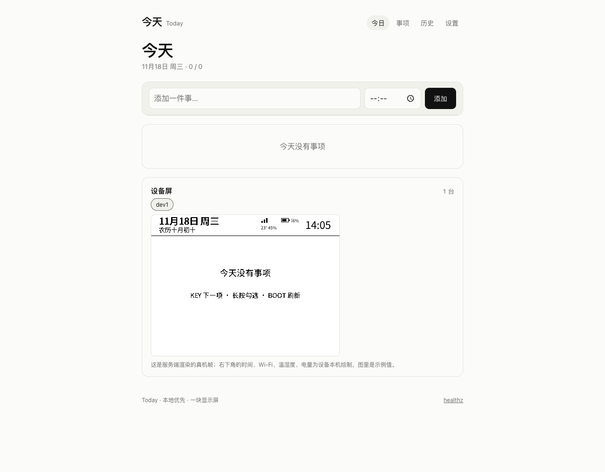
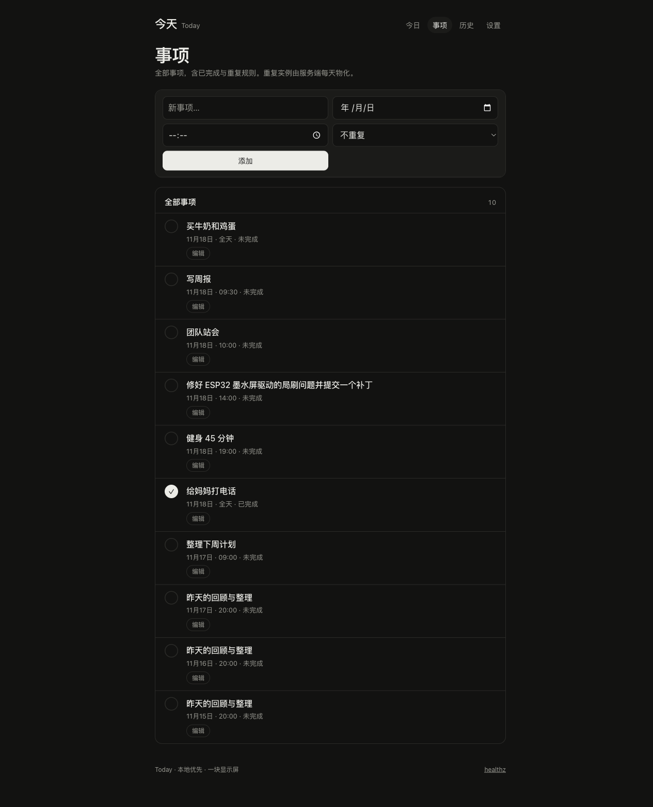
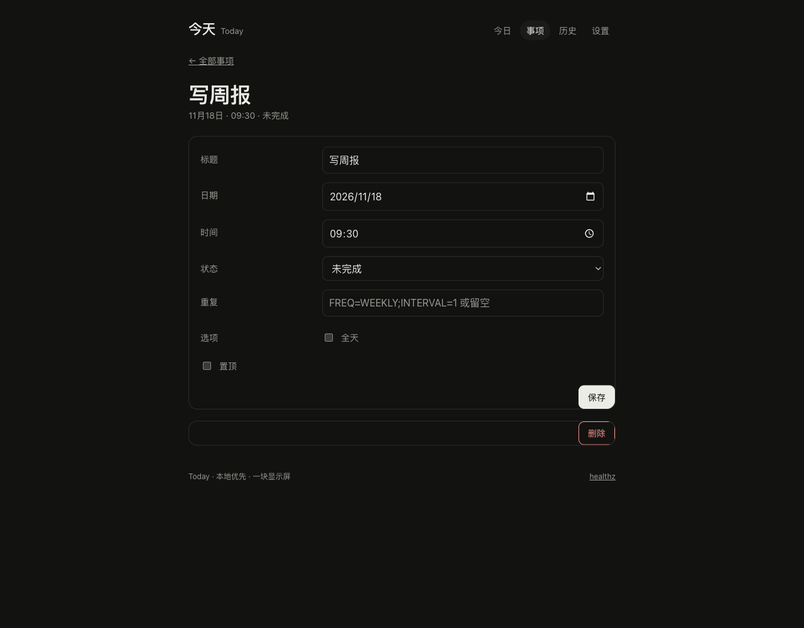

# 使用教程

Today 是 macOS 菜单栏里的一个「今天」应用：网页是唯一界面，一块 4.2" 反射 LCD 常亮显示今天的事项。数据全部在本机 SQLite 里。


## 1. 安装

1. 下载 `Today-<版本>.dmg`，打开后把 `Today.app` 拖进「应用程序」。
2. 首次打开若提示「无法验证开发者」（未签名/未公证的构建）：
   - 右键点 `Today.app` → 打开 → 再点「打开」；
   - 或「系统设置 → 隐私与安全性」底部点「仍要打开」。
   - **签名并公证后的正式发行版不需要这一步。**
3. 应用是菜单栏程序（`LSUIElement`），不会出现在 Dock；图标在屏幕右上角。

首次启动会生成 12 位访问口令：打印在 stderr、复制到剪贴板，并自动打开 `/login`。忘了口令可以重设：

```sh
todayd passwd --db "$HOME/Library/Application Support/Today/today.db"
```

（在 `Today.app/Contents/MacOS/` 里也有同名的 `todayd`；或者用源码 `go run ./cmd/todayd passwd`。）

> 文档中的 `todayd` 都指这个二进制；路径里的 `~/Library` 是 macOS 的用户库目录，不是某个人的绝对路径。

## 2. 登录

浏览器打开菜单栏「打开今日页面 → 在浏览器打开」，输入口令进入 `/app`。会话是一枚 HttpOnly cookie；换口令后所有旧会话立即失效。


## 3. 今日

- 顶部是日期、星期和进度（完成数 / 总数）。
- 输入框加一件事：只填标题 = 全天；填时间 = 定时事项。回车或点「添加」。
- 每行左侧的圆圈勾选完成；已完成的会沉到底部并加删除线。
- 点标题进入事项详情。
- 页面下方「设备屏」内联显示设备帧（400×300）；多台设备时可切换标签。图里右上角的时钟、Wi-Fi、电量、温湿度是设备本机绘制，预览里是示例值。
- 列表为空时显示「今天没有事项」。



## 4. 事项

所有事项都在这里，包括已完成和重复实例。



- 添加表单支持日期、时间和重复规则（每天 / 每周 / 每月）。
- 每一行是「标题 + 一行元信息」，点「编辑」展开行内表单，可改标题、日期、时间、状态、全天、置顶、重复规则。
- 重复事项由服务端每天物化：改单条实例只影响那一天，改原始事项会同步未来实例。
- 删除有确认框。

点标题进入详情页，字段与行内编辑一致，底部有删除。



## 5. 历史

今天之前的事项，最近 200 条，按日期倒序。


## 6. 设置


### 常规

- **端口**：当前监听地址；被别的程序占用时会自动退到相邻端口，设置页会写明。改端口后记得同步设备的 `server` 地址。
- **更新源**：留空关闭检查更新；支持 GitHub releases/latest 或自定义 `{version,url}` JSON。
- **状态栏**：菜单栏标题是否显示 `完成/总数`。
- **开机自启**：登录时启动（需要打包后的 `.app`）。
- **时区**：IANA 名称（如 `Asia/Shanghai`），带可搜索的候选列表；留空或旧值 `Local` 会按系统时区显示，保存时写成具体 IANA 名。
- **夜间熄屏**：默认 23:00–07:00；到点关屏，按键临时点亮 30 秒；跨午夜自动处理。
- **外网访问**：见第 9 节。

### 安全

改口令（至少 8 位，所有会话立即失效）、登出所有设备。

### 设备

- **添加设备**：填 ID（小写字母、数字、`-`、`_`）和名称。
- **生成 token**：只在生成后显示一次；同一处给出四行串口命令（下图的 `<token>` 和 `192.168.1.10` 是占位示例）：
  ```
  wifi <SSID> <password>
  server http://<本机局域网地址>:<端口>
  device dev1
  token <token>
  ```
  点「复制命令」整段复制，粘进串口即可配网。
- **预览**：打开该设备的 400×300 帧图。
- **吊销**：立刻让旧 token 失效。
- 设备行显示上次取帧时间、电量（mV）与供电状态（如果设备上报）。

### 固件

上传 `firmware.bin`，设备下次取帧时自动 OTA；A/B 分区保留上一版。

## 7. 设备操作

板上只有两个键：

| 操作 | 效果 |
|---|---|
| **KEY 短按** | 光标移到下一项（循环） |
| **KEY 长按 ≥0.6 s** | 勾选 / 取消勾选当前行，立即上报并刷新 |
| **KEY 按住 3 s** | 打开 SoftAP 配网热点 `Today-XXXX` |
| **BOOT 短按** | 强制整帧刷新（`?force=1`） |
| **PWR 单击 / 长按** | 上电 / 断电 |

注意：

- **BOOT 不能在上电时按住**：它是 strapping 脚，按住上电会进下载模式而不是运行固件。
- **常亮模式需要插 USB**：这块板的深睡约 6–7 mA，18650 撑不了几天；项目按常亮设计。
- **屏幕无背光**：反射 LCD，靠环境光；光线越足越清楚，弱光下就是偏暗。
- 夜间熄屏时第一次按键只点亮屏幕，不会误勾选；30 秒无操作再熄。

## 8. 外网访问（Tailscale Funnel）

菜单栏「外网访问」勾选后由宿主启动 Funnel，状态会同步到托盘和设置页：

| 状态 | 含义 | 点击「继续设置」会 |
|---|---|---|
| 未安装/不支持 | 找不到 Tailscale CLI | 打开下载页 / 开源版说明 |
| 未登录 | 没有授权或后台没起来 | 运行 `tailscale up`，抓授权链接用浏览器打开 |
| 需要开启 HTTPS/Funnel | tailnet 未开 HTTPS 或没有 funnel 节点属性 | 打开对应控制台页面 |
| 正在连接 | 已具备条件，等待生效 | 退避重试 `funnel --bg <端口>`（1→2→5 分钟，绝不 `funnel reset`） |
| 已开启 | 公网地址可用 | 在浏览器打开公网地址 |

**重要：macOS 上 Funnel 只支持开源版 `tailscale`+`tailscaled`。** App Store 版和官网 Standalone 版在官方对比表里 Funnel 一栏是 `no`（沙箱限制）；装了图形版也开不了，程序会提示改安装开源版。

安装开源版后，Funnel 默认走公网 443，转发到本机监听端口（如 8787），不需要把 Today 的监听端口改成 443。

## 9. 数据、备份、卸载

- 数据库：`~/Library/Application Support/Today/today.db`；端口配置在同目录的 `config.json`。
- 备份：退出应用后整目录复制即可；SQLite 是 WAL 模式，运行中复制要连同 `-wal`、`-shm`。
- 卸载：退出应用，删掉 `Today.app` 与上面那个目录。登录项可在「系统设置 → 通用 → 登录项」里移除。

## 10. 常见问题

| 现象 | 处理 |
|---|---|
| 网页打不开 | 端口可能被别的服务占用：编辑 `config.json` 的 `listen_addr`，或托盘菜单换端口 |
| 忘了口令 | `todayd passwd` 重设 |
| 设备一直空白 | 检查 `server` 地址是否能从设备访问到 Mac；token 是否最新 |
| 时间不动 | 设备没联网时靠 RTC；检查 RTC 纽扣电池（必须可充电 ML1220） |
| 外网显示「需要开启 HTTPS」 | 在 Tailscale 控制台为 tailnet 开启 HTTPS 证书 |
